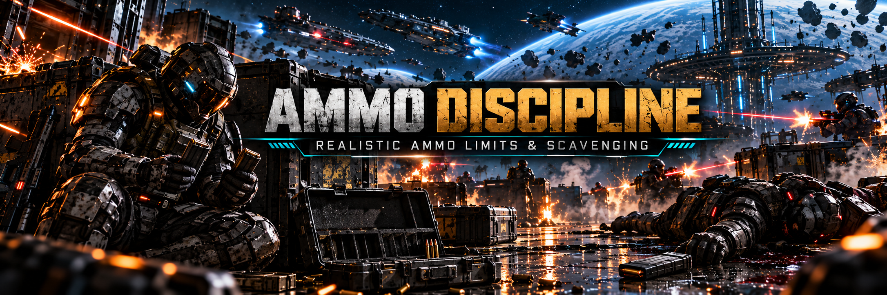

# Ammo Discipline: realistic ammo limits and scavenging for SpaceBourne 2

You carry a few magazines, not a thousand rounds. A dead enemy gives you what was left in their
magazine, or nothing. Crates give a handful, and a magazine you drop during a reload is gone.
Every magazine counts, and the weapon you bring matters.

An idea by TheCalcMan (Steam).

Version 0.1.2 · UE4SS Lua mod · [Nexus Mods page](https://www.nexusmods.com/spacebourne2/mods/12) ·
[GitHub](https://github.com/hubertdungen/SpaceBourne2-AmmoDiscipline) ·
works alone or with [Hardcore Tactical Realism](https://github.com/hubertdungen/SpaceBourne2-HardcoreTacticalRealism)
and the rest of the realism set.

## What it does

**Carry limits per ammo type.** These are the spare rounds you carry, next to the game's own limit:

| Ammo | Limit | Game's limit |
|---|---|---|
| rifle and SMG rounds or cells | 240 | 999 |
| sniper and hunter rounds | 40 | 99 |
| laser sniper and hunter cells | 60 | 125 |
| shotgun shells | 32 | 299 |
| laser shotgun cells | 48 | 99 |
| pistol rounds or cells | 60 | 999 / 299 |

Rifle magazines hold 50 to 100 rounds, so 240 rounds is a few magazines, plus the one in your gun.
Once you reach a limit, pickups of that type stop, with "Pouch full" on the HUD. On an old save
with hundreds of rounds, the excess is left behind once, and the HUD says so.

- **Dead enemies give what they carried.** The game gives 40 to 100 rounds of a random type from 70 % of
  the dead. With Ammo Discipline you get:
  - the rounds left in the enemy's magazine;
  - sometimes a spare magazine (bosses always have one);
  - sometimes nothing usable;
  - heavy rounds from a sniper, rifle rounds from everyone else;
  - nothing from melee fighters and robots.
- **Crates and loot give less.** An ammo crate gives about a quarter of your
  limit for each type (about 60 rifle rounds, 8 shotgun shells) instead of 100. Ammo lying around
  gives about 15 % of the limit (about 36 rifle rounds). Shops and rewards are never reduced (you paid), but they stop at the limit.
- **Reloading drops the magazine.** The rounds left in it are lost, and the new magazine comes
  from your pouch. Reload when you're nearly empty, not after every burst.
- **Your pistol needs ammo too.** The game gives pistols infinite ammo. Here they use pistol rounds or
  cells from the pouch. Ammo crates have them, and some dead enemies carry their sidearm's rounds.
- **HUD lines** when it matters:
  - "Last magazine: 37 rifle rounds left";
  - "Out of spare rifle rounds";
  - "Pouch full: max 240 rifle rounds".

  They make no beep, stay about 5 seconds, and the same line comes back at most once in 30 seconds.
  A line for each pickup ("+18 rifle rounds") is off by default: the HUD counter shows it.
- **One click on an empty gun.** Pulling the trigger on an empty gun clicks once, not over and over
  while you hold it.
- **On by default.** **Shift+0** switches it off (the game's limits come back) and on again.

## Requirements

- SpaceBourne 2 (Steam).
- [UE4SS 3.0.1](https://github.com/UE4SS-RE/RE-UE4SS/releases/tag/v3.0.1), a free script loader
  for Unreal Engine games. Installing HTR or the realism set installer installs it too.

## Install

Option A (recommended): the [SpaceBourne 2 Realism installer](https://www.nexusmods.com/spacebourne2/mods/11).

Option B, manual:

1. Download `AmmoDiscipline-0.1.2.zip` from the
   [releases](https://github.com/hubertdungen/SpaceBourne2-AmmoDiscipline/releases).
2. Extract it into the game folder (`...\steamapps\common\SpaceBourne 2\`). It adds
   `SB2\Binaries\Win64\Mods\AmmoDiscipline\`, and the `enabled.txt` inside turns it on.
3. That's it: it is on in game.

To uninstall, delete `SB2\Binaries\Win64\Mods\AmmoDiscipline`. The game's limits come back next time you
play. Rounds that were left behind or never picked up do not come back.

**Your save:** the spare rounds are part of the game's own data, so the limits are saved with your
game like any ammo you spend. Ammo Discipline writes no files of its own to your saves.

## Controls

**Shift+0** switches Ammo Discipline on/off (change it with `ToggleKey` in `scripts\config.lua`).

## Settings

Edit `Mods\AmmoDiscipline\scripts\config.lua` with Notepad. Every line is optional.
- `Caps`: the limit per ammo type.
- `TrimToLimit`: whether extra rounds on an old save are left behind.
- `Scavenge`:
  - what bodies give: `NothingChance` (25 %), `SpareMagazineChance` (20 %), `HeavyRoundsShare`,
    `RobotsCarryAmmo`, `SidearmChance`;
  - crates: `CrateShare` (25 % of the limit);
  - loot: `LootShare` (15 % of the limit);
  - `Enemies`, `Crates` and `Loot` switch each one off.
- `Reload.DropMagazine`: `false` keeps the game's top-up reload. `Reload.OneDryClick`: `false` gives back the
  game's clicking on an empty gun.
- `Pistols.LimitedAmmo`: `false` gives back infinite pistol ammo.
- `Messages`: switch off any HUD line. `DroppedMagazine` adds a line on every reload; `Pickups` a line
  for each pickup. `Quiet = false` gives the lines the HUD's beep back.

## Works with the realism set

- **Hardcore Tactical Realism:** HTR sets the enemies' magazines (30 or 40 rounds), and Ammo
  Discipline reads them when an enemy dies. HTR's ballistics are unchanged.
- **Tactical Engineering:** your turret keeps its own 300 rounds and its refill at the ship. It does
  not use your pouch.
- **Silent Ops:** fitting a suppressor still blocks firing as before.
- **Gear Without Levels:** independent.

## Status and known limits

<!-- nexus:skip -->
Tested in game on 2026-10-31, with HTR 0.4.8, Silent Ops, Split Controls, Gear Without Levels and SB2 HOTAS:
- limits on load: an old save's 999 rounds were cut to the limit plus one magazine;
- a shop-style pickup stopping at the limit;
- reloading with 10 rounds left: the magazine was dropped and a full one came from the pouch;
- enemy drops: the game's 50–79 rounds became 17–39, of the type the enemy carried;
- an ammo crate (100 → 30 of each type) and ammo lying around (40 → 20);
- the pistol reloading from pistol rounds;
- switching it off and on with a real key press;
- frame times with and without the mod.

0.1.1 and 0.1.2 were tested in game on 2026-11-06 with HTR 0.4.11 and the rest of the set:
- the HUD number equal to the pouch after ammo lying around, a crate and enemy drops;
- a crate: rifle +50, sniper +8, shotgun +7 (a quarter of each limit, give or take);
- ammo lying around (100 rifle rounds): +40;
- a dead enemy's shotgun shells taken back, without a "Pouch full" line;
- HUD lines without the beep, still on screen after 3 s, not repeated within 30 s;
- an empty rifle with the trigger held: one click.
<!-- /nexus:skip -->

Known limits:
- **The game's ammo counter shows your spare rounds, not the limit.** The limits show in the HUD
  lines above.
- **Enemies with no data.** If the game drops ammo for an enemy Ammo Discipline did not see, you get
  a quarter of the game's amount.
- **Swapping weapons in the inventory** unloads the magazine into your pouch. One magazine may sit on
  top of a full pouch.

Design notes, research and the test log: [DESIGN.md](DESIGN.md).

## Part of the SpaceBourne 2 realism set

This mod is part of the realism set, built around [Hardcore Tactical Realism](https://www.nexusmods.com/spacebourne2/mods/4) as the core mod. HTR is not required: this mod works on its own or with any of the others. **Install them all at once** with the [SpaceBourne 2 Realism installer](https://www.nexusmods.com/spacebourne2/mods/11) ([GitHub](https://github.com/hubertdungen/SpaceBourne2-Realism)): tick the mods you want, and it switches them on and keeps them up to date.

- **Hardcore Tactical Realism (HTR)**: the core: realistic ballistics, wounds and tactical AI. [GitHub](https://github.com/hubertdungen/SpaceBourne2-HardcoreTacticalRealism) · [Nexus](https://www.nexusmods.com/spacebourne2/mods/4) · [Steam](https://steamcommunity.com/app/1646850/discussions/0/573805072991123580/)
- **Split Controls**: separate look inversion for ships and on foot. [GitHub](https://github.com/hubertdungen/SpaceBourne2-SplitControls) · [Nexus](https://www.nexusmods.com/spacebourne2/mods/5)
- **Silent Ops**: realistic stealth, suppressors and silent takedowns. [GitHub](https://github.com/hubertdungen/SpaceBourne2-SilentOps) · [Nexus](https://www.nexusmods.com/spacebourne2/mods/6)
- **Gear Without Levels**: any weapon or suit at any level, with small penalties. [GitHub](https://github.com/hubertdungen/SpaceBourne2-GearWithoutLevels) · [Nexus](https://www.nexusmods.com/spacebourne2/mods/7)
- **SB2 HOTAS**: joystick, HOTAS, pedals, head tracking and triple screen. [GitHub](https://github.com/hubertdungen/SpaceBourne2-HOTAS) · [Nexus](https://www.nexusmods.com/spacebourne2/mods/8)
- **Faction Power**: dungeons, sales and missions earn your faction power. [GitHub](https://github.com/hubertdungen/SpaceBourne2-FactionPower) · [Nexus](https://www.nexusmods.com/spacebourne2/mods/9)
- **Tactical Engineering**: deployable turrets and barricades that take time to set up. [GitHub](https://github.com/hubertdungen/SpaceBourne2-TacticalEngineering) · [Nexus](https://www.nexusmods.com/spacebourne2/mods/10)
- **Ammo Discipline** *(this mod)*: realistic ammo limits and scavenging. [GitHub](https://github.com/hubertdungen/SpaceBourne2-AmmoDiscipline) · [Nexus](https://www.nexusmods.com/spacebourne2/mods/12)
- **Ground Waypoints**: planet waypoints on foot and on the hoverbike. [GitHub](https://github.com/hubertdungen/SpaceBourne2-GroundWaypoints) · [Nexus](https://www.nexusmods.com/spacebourne2/mods/13)
- **Get Out of the Way**: NPCs step aside naturally when you walk through them. [GitHub](https://github.com/hubertdungen/SpaceBourne2-GetOutOfTheWay) · [Nexus](https://www.nexusmods.com/spacebourne2/mods/14)

Coming soon: Tactical First Person.

## Thanks

**TheCalcMan** (Steam), for the idea of this mod and for play-testing the realism set.

## License

MIT. See [LICENSE](LICENSE).
